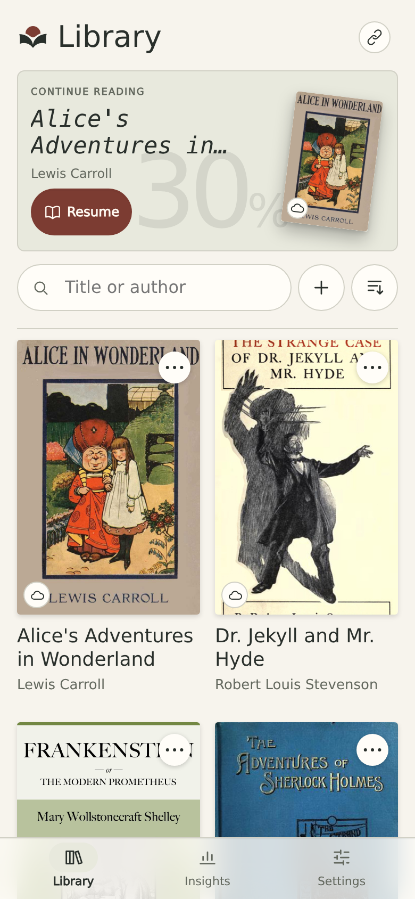
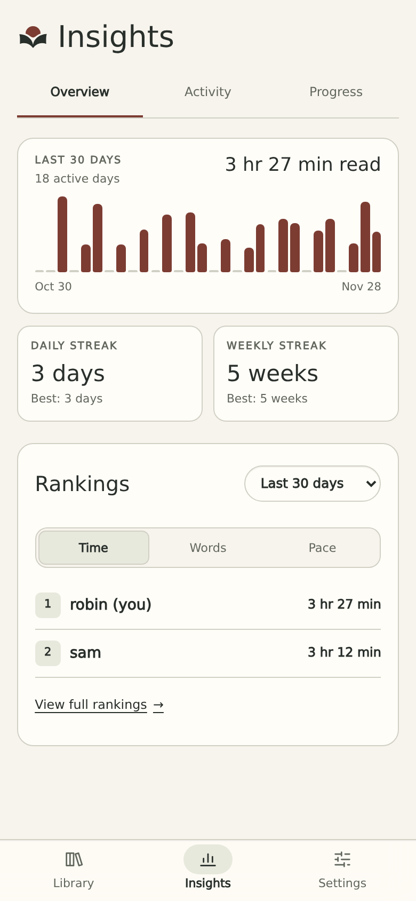
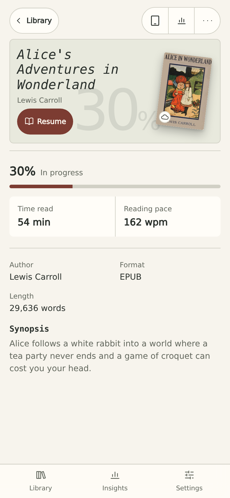
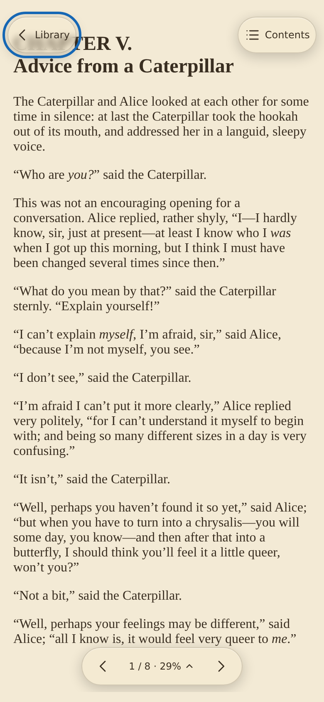

<p align="center"></p>

<p align="center">
    <a href="screenshots/mobile/home.png"></a>
    <a href="screenshots/mobile/overview.png"></a>
    <a href="screenshots/mobile/book.png"></a>
    <a href="screenshots/mobile/reader.png"></a>
</p>

<p align="center">
    <a href="https://gitea.va.reichard.io/evan/AnthoLume/actions" target="_blank">
        
    </a>
</p>

---

AnthoLume is a Progressive Web App (PWA) that manages your EPUB documents, provides an EPUB reader, and tracks your reading activity! It also has a [KOReader KOSync](https://github.com/koreader/koreader-sync-server) compatible API, and a [KOReader](https://github.com/koreader/koreader) Plugin used to sync activity from your Kindle. Some additional features include:

- OPDS API Endpoint
- Browser EPUB reader with on-device caching
- Book identification with [Open Library](https://openlibrary.org/)
- Words / Minute (WPM) Tracking & Leaderboard (Amongst Server Users)

## Server

Docker Image: `docker pull gitea.va.reichard.io/evan/antholume:latest`

### EPUB Reader

Sign in over HTTPS (or localhost) to cache books. In the Library, choose **••• → Save to Device** to download a book without opening it. Saved books are kept outside the automatic six-book, 768 MiB cache. **Remove from Device** clears the download for all local profiles without deleting reading records or the server book. When offline, pick a remembered profile and read any book cached from the same library. Offline profiles are passwordless, including after sign-out; **Forget on This Device** removes a profile and its unsubmitted drafts.

A book opened while signed in queues progress and activity for that account, even if the connection drops. A book opened from the offline shelf stays device-only for that reading session, even after reconnecting. Sign in and choose **Upload Selected** to share those records. Review progress and activity separately for each book. Server activity covers the same dates as the offline reading. Clearing browser storage removes downloads and unsubmitted drafts.

### KOSync API

The KOSync compatible API endpoint is located at: `http(s)://<SERVER>/api/ko`

### OPDS API

The OPDS API endpoint is located at: `http(s)://<SERVER>/api/opds`

### Quick Start

Set `PUBLIC_ORIGIN` to the exact browser origin, with no trailing slash. Explicit default ports (`:443` for HTTPS, `:80` for HTTP) are omitted before matching browser requests. Use HTTPS for deployed instances. Loopback HTTP is allowed for local development. Cookies are always `HttpOnly` and use `Secure` when `PUBLIC_ORIGIN` is HTTPS.

Optional Hardcover integration: register a [server-side OAuth app](https://hardcover.app/account/developer-apps/new) with redirect URI `{PUBLIC_ORIGIN}/oauth/hardcover/callback` and scopes `read:me:content` and `read:library`. Set `HARDCOVER_CLIENT_ID`, `HARDCOVER_CLIENT_SECRET`, and `HARDCOVER_TOKEN_KEY` on the server. Generate the token key **once** with `openssl rand -base64 32` and keep it in your deployment’s secret store, separate from the OAuth client secret. It encrypts reader tokens in SQLite. Keep it stable across restarts; changing it makes existing tokens unreadable.

Readers can choose **Settings → Connect Hardcover** to preview their Want to Read shelf. This does not request downloads or change reading status. Deleting a reader deletes their local link. Database and archive backups omit reader OAuth links because refresh tokens rotate. After restoring a backup, readers reconnect in Settings.

**Identify Book** uses Open Library by default. To use the Hardcover catalog instead, create a [Hardcover API token](https://hardcover.app/account/api) with `read:catalog` access. Set the raw token as `HARDCOVER_CATALOG_TOKEN` in the server environment, restart, then select **Hardcover** under **Settings → Administration → Library → Metadata provider**. This applies to the entire instance and does not require reader OAuth. Backups contain the provider choice and confirmed work links, not the catalog token. If you remove the token and restart, Open Library becomes active until you restore the token or change the choice. An expired token or failed Hardcover request reports an error instead of switching providers. With Docker Compose, supply the token in the deployment environment and recreate the container after changing it.

In **Identify Book**, previewing a result saves nothing. **Link Book** confirms the provider’s work ID without changing your metadata; **Link and Apply** also saves the selected fields. Switching providers does not remove existing links: a library book can have a confirmed Open Library match and a confirmed Hardcover match.

```bash
# Make Data Directory
mkdir -p antholume_data

# Run Server
docker run \
    -p 127.0.0.1:8585:8585 \
    -e PUBLIC_ORIGIN=http://localhost:8585 \
    -e REGISTRATION_ENABLED=true \
    -v ./antholume_data:/config \
    -v ./antholume_data:/data \
    gitea.va.reichard.io/evan/antholume:latest
```

The service is now accessible at `http://localhost:8585`. Register an account, then disable registration unless you expect more users.

### Book Storage and Upgrades

When the new app first loads on a browser, it deletes the previous release’s local IndexedDB data, including local-only EPUBs and unsynced reading history. Save local originals and sync reading history on the previous release before upgrading. Server data and the current reader’s IndexedDB data are not deleted.

Configure storage roots in **Settings → Administration → Library**. Library is the only managed root and defaults to `$DATA_PATH/documents`. Imported books can be copied into Library or referenced in place from a source root. In Docker, mount source directories into the container before adding them. To relocate a source without changing book IDs or reading history, edit the existing root and keep paths relative to that root unchanged. If you change `DATA_PATH` during an upgrade, books with a recorded path outside the new Library stay on an unmanaged source. If you moved those books into the new Library folder, point the source at that folder and confirm **Merge into Library**.

Backups download on demand and the server does not retain a copy. Before restoring, download a backup if you want to keep the current data. Backups always include the database; **Database + Library files** also includes cataloged Library EPUBs and covers. Source files are not included. If **Create Backup** reports an invalid catalog path, place the original file under a safe name and relink it, or explicitly clear the reference. Clearing does not delete files or reading history. A full restore copies bundled books into the current Library without overwriting existing files. A matching KOReader book can be reused; otherwise, a path collision gets a new filename in the restored catalog. A database-only restore leaves all files untouched. Restore runs pending migrations on a staged copy before asking for confirmation. Backups from a newer database version are rejected. After restore, readers reconnect Hardcover in Settings; admins review source mappings before re-enabling auto-import schedules. Legacy source folders still need to be mapped locally.

### Configuration

| Environment Variable | Default Value | Description                                                                |
| -------------------- | ------------- | -------------------------------------------------------------------------- |
| DATABASE_TYPE        | SQLite        | Currently only "SQLite" is supported                                       |
| DATABASE_NAME        | antholume     | The database name, or in SQLite's case, the filename                       |
| CONFIG_PATH          | /config       | Absolute directory path where SQLite's DB is stored                                       |
| DATA_PATH            | /data         | Directory where to store the documents and cover metadata                  |
| PUBLIC_ORIGIN        | Required      | Exact browser origin (HTTPS, or HTTP for loopback development)             |
| LISTEN_HOST          |               | Interface address to bind; empty listens on all interfaces                |
| LISTEN_PORT          | 8585          | Port the server listens at                                                 |
| TRUSTED_PROXIES      |               | Comma-separated proxy IPs or CIDRs; empty ignores forwarded client IP headers |
| LOG_LEVEL            | info          | Set server log level                                                       |
| REGISTRATION_ENABLED | false         | Whether to allow registration (applies to both WebApp & KOSync API)        |
| COOKIE_AUTH_KEY      | <EMPTY>       | Optional secret cookie authentication key (auto generated if not provided) |
| COOKIE_ENC_KEY       | <EMPTY>       | Optional secret cookie encryption key (16 or 32 bytes)                     |
| HARDCOVER_CATALOG_TOKEN | <EMPTY>    | Optional server-only Hardcover catalog API token; enables the admin choice |

## Security

Behind a reverse proxy, set `TRUSTED_PROXIES` to the proxy addresses as seen by AnthoLume (for example, `127.0.0.1,172.20.0.10`). List only proxies you control. Configure them to sanitize `X-Forwarded-For` and `X-Real-IP` from untrusted clients so credential rate limits use the actual client IP.

### Authentication

- _Web App / PWA_ - Session based token (7 day expiry, refresh after 6 days)
- _KOSync & SyncNinja API_ - Header based - `X-Auth-User` & `X-Auth-Key` (KOSync compatibility)
- _OPDS API_ - Basic authentication (KOReader OPDS compatibility)

### Notes

- Credentials are the same amongst all endpoints
- The native KOSync plugin sends an MD5 hash of the password. Due to that:
- We store an Argon2 hash _and_ per-password salt of the MD5 hashed original password

## Client (KOReader Plugin)

See documentation in the `client` subfolder: [SyncNinja](https://gitea.va.reichard.io/evan/AnthoLume/src/branch/master/client/)

## Development

SQLC Generation (v1.26.0):

```bash
go install github.com/sqlc-dev/sqlc/cmd/sqlc@latest
~/go/bin/sqlc generate
```

Goose Migrations:

```bash
go install github.com/pressly/goose/v3/cmd/goose@latest
```

Run `make dev` for a persistent library seeded with demo books on first launch at `http://localhost:5323`. For offline testing, Vite hot reload, backup seeding, and optional Tailscale access, see [web development](web/README.md).

Pull requests run Go tests, the frontend build, unit tests, and a browser smoke suite. The full race, app-browser, and reader suites run monthly, on dispatch, and on tags: comment `/publish` on a same-repository pull request to build and receive a `pr-<number>-<commit>` image reference.

## Building

The `Dockerfile` and `Makefile` contain the build information:

```bash
# Build Local (Linux & Darwin - arm64 & amd64)
make build_local

# Build Local Docker Image
make docker_build_local

# Build Docker & Push Latest or Dev (Linux - arm64 & amd64)
make docker_build_release_latest
make docker_build_release_dev

# Build React assets
make build_web

# Clean Local Build
make clean

# Tests (after building React assets)
make tests
npm --prefix web test
```

## Notes

- Icons: https://www.svgrepo.com/collection/solar-bold-icons
- Icons: https://www.svgrepo.com/collection/scarlab-solid-oval-interface-icons/
