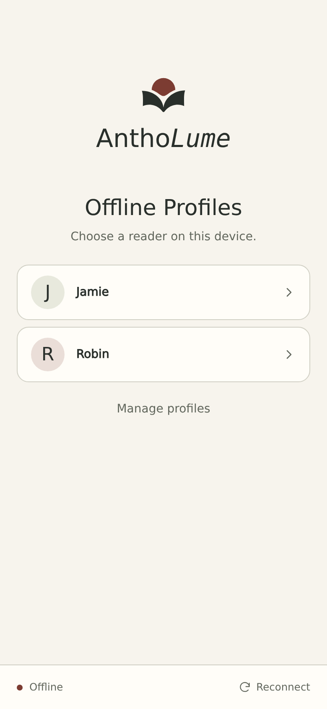
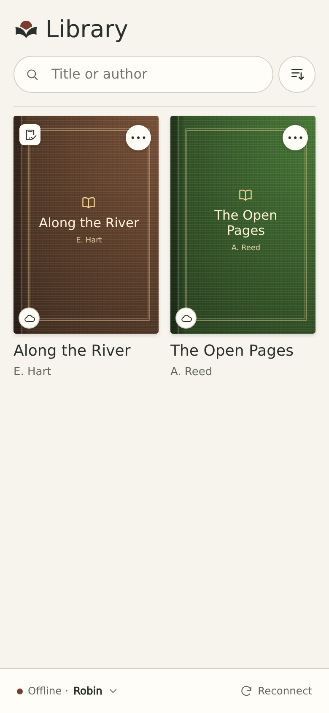
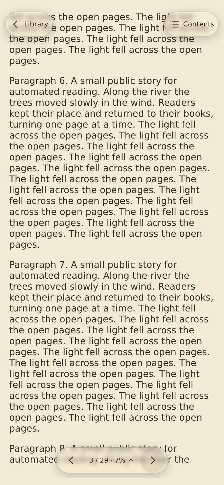
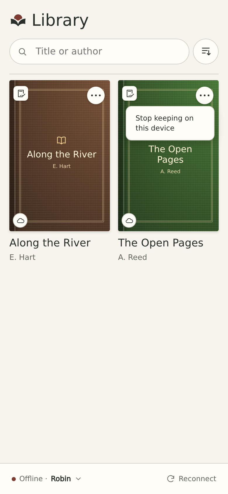
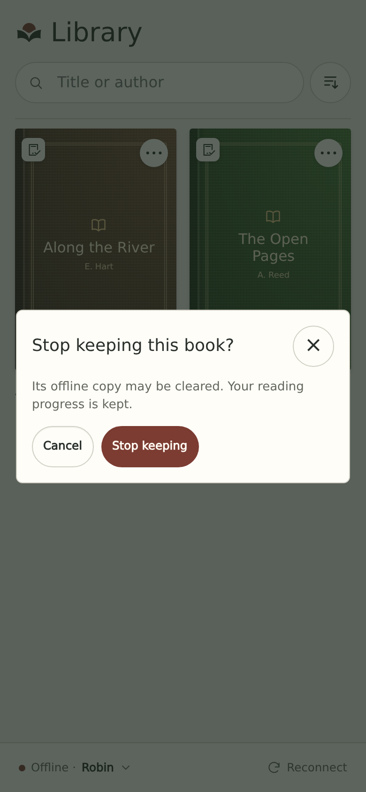
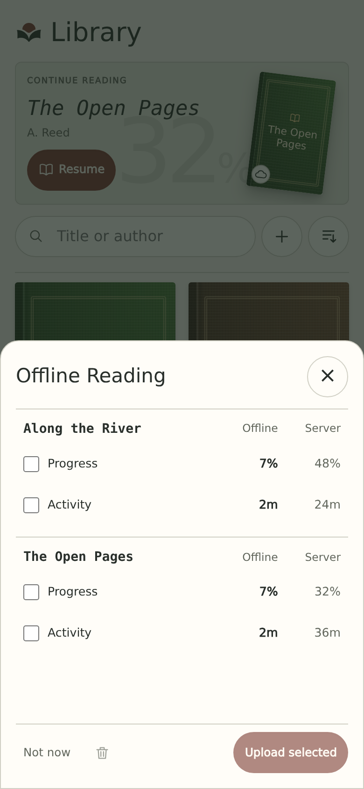
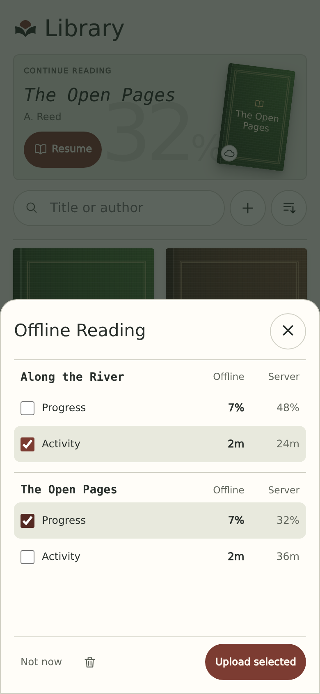
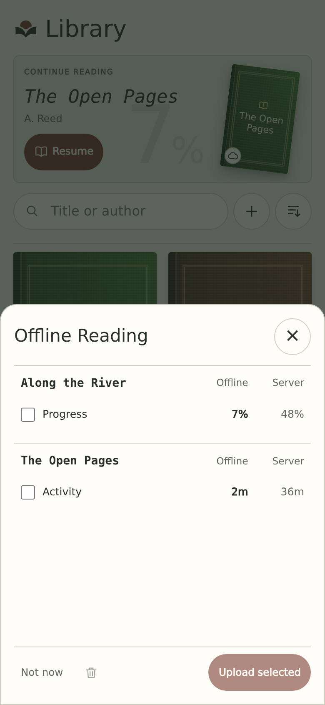

# Offline reading and upload review

Captured from the running app in mobile Chromium (390 × 844). Select a screenshot to view it at full size.

| 1. Choose an offline profile | 2. Open a cached book | 3. Read offline |
| --- | --- | --- |
|  |  |  |

The bottom bar offers **Reconnect** on both screens and a profile switcher only after selection. A device ✓ marks a book kept on this device.

| Book options | Confirm before releasing a kept copy |
| --- | --- |
|  |  |

| 4. Review after reconnecting | 5. Choose what to upload | 6. Review what remains |
| --- | --- | --- |
|  |  |  |

Robin uploads the two minutes read in *Along the River* without replacing the server’s 48% bookmark. For *The Open Pages*, Robin uploads only the offline bookmark. The other two items remain available for later review.
